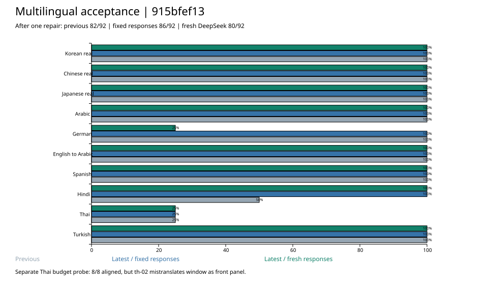

# Multilingual acceptance: 915bfef13

Conclusion: **The Hindi citation fix passes. Thai word segmentation can complete alignment on input with a reading budget, but content errors remain; overall, this cannot be judged as fully passing.**

This round started the build from `915bfef1308a070c0a720682b961744cf156ec4b`. In the meantime, other sessions committed Web/wasm changes, and the final HEAD is `e3ec02730`. Before and after the build, the Rust source file digests of `ccut-flow-core`, `ccut-engine` and `ccut-speech-core` were all identical. This round does not modify production code.

## Comparison with the previous round

Using the same 92 sentences as the [previous-round acceptance](../lean-carrier-acceptance-2026-10-01/README.md) (36 sentences sampled from real projects, 56 synthetic), with the model config ID `deepseek-flash` (DeepSeek V4.1 Flash, as specified by the user).

| Basis | First-pass accepted | First-pass aligned | Accepted after one re-run | Aligned after one re-run | Needs rewrite in the end |
| --- | ---: | ---: | ---: | ---: | ---: |
| Previous round's new-model results | 92 | 79 | 92 | 82 | 10 |
| Latest code replaying previous-round responses, keeping previous-round inputs | 92 | 83 | 92 | **86** | 6 |
| Latest code replaying previous-round responses, synthetic text segmented with the new version | 92 | 83 | 92 | **86** | 6 |
| Latest code, new model call, synthetic text segmented with the new version | 91 | 77 | 92 | **80** | 12 |

The denominator is 92 in every row. The fixed responses control the model output, and they confirm that the code change raises 4 sentences, all from Hindi. The new calls were run only once, so 82→80 should not be treated as a deterministic algorithmic regression. The 6 German→English sentences all came back as one large block this time, and the re-run did not split them. Hindi, by contrast, went from 4/8 to 8/8. After this round's re-run, all three real-project groups are 36/36 aligned. One Chinese sentence failed the format check on the first pass, and the re-run recovered it.



| Source-language group | Sample | Previous-round aligned | New version, fixed-response replay | New version, new response |
| --- | ---: | ---: | ---: | ---: |
| Korean (real) | 12 | 12 | 12 | 12 |
| Chinese (real) | 12 | 12 | 12 | 12 |
| Japanese (real) | 12 | 12 | 12 | 12 |
| Arabic | 8 | 8 | 8 | 8 |
| German | 8 | 8 | 8 | 2 |
| English→Arabic | 8 | 8 | 8 | 8 |
| Spanish | 8 | 8 | 8 | 8 |
| Hindi | 8 | 4 | 8 | 8 |
| Thai | 8 | 2 | 2 | 2 |
| Turkish | 8 | 8 | 8 | 8 |

## Thai with reading budget: structure passes, content does not

The original synthetic benchmark had no `data-budget`, so it did not trigger some production chunking hints. This round took the same 8 Thai sentences, injected a simulated reading budget, and reports them separately rather than merging them into the main 92-sentence table.

- Simulated duration = reference English translation word count / 2.7. The budget is calculated from the current `reading_budget_duration`: English 21 units/second, Chinese 9 units/second. These are experimental assumptions, not real media timings.
- First pass: **8/8 accepted, 8/8 aligned**. 36 chunks were located for 35.
- `th-04` has one citation where `เมื่อวาน` (yesterday) is written as `เมื่อยาน`. It still has `anchor-unresolved`, but the planner used the remaining evidence to generate an alignment. 8/8 aligned must not be written up as meaning every citation is correct.
- `th-02` **newly found a confirmed content error:** the source `ปิดหน้าต่าง` means "close the window", but the new translation is `close the front panel`. It still ends as `aligned`, and it produced a subtitle split between `front | panel`.
- This prompt included `ต่ำกว่า5อง ¦ ศาให้ปิดหน้า ¦ ต่างก่อนเปิดเครื่อง`, which splits `องศา` (degrees) and `หน้าต่าง` (window). The model response likewise wrote `de|grees` and `front | panel`. The final cleanup merged degrees but did not correct front panel. The break hint appeared together with the error, but single sampling is not enough to prove causation.

Suggested next steps, in priority order: first verify that the forced `¦` should not be emitted at low-confidence source word boundaries, and repeat sampling with a control arm that "keeps the full source sentence and only requires the target text to be chunked". Also add keyword and relation checks for `th-02`. First confirm that the break hint does not induce mistranslation, and only then raise the chunking success rate. Do not substitute more retries for this verification.

## Re-check of previously failing items

- **Hindi citation localization: pass.** The fixed replay of `hi-03`, `hi-05`, `hi-06` and `hi-07` all moved from needs-rewrite to aligned. The new model is 8/8 aligned.
- **Thai word segmentation: conditional pass on structural tests.** The new `atomize-words` produced 16/19 word units for th-01/th-02. All 10 segmentation and glue-concatenation probes kept the original text, including Thai, Lao, Khmer and Burmese. Keeping the text unchanged does not mean the segmentation is linguistically accurate, and splits such as `หน้า/ต่าง` still need handling.
- **German `de-07` semantics: unresolved.** The new response still reads "Only after the second-version owner agrees will the file be sent to Anna." The source requires management approval of the second version. The newly added `translation-meaning-unverified` only honestly reports that the meaning was not checked. The related tests pass, but it does not automatically fix this mistranslation.
- **Hindi `hi-07` semantics: not counted as a definite error.** The new response still says "another version". The source word can be read as "second" or "another", so it needs context or native-speaker review. Correcting the overly strong error attribution from the previous round, this round only records the ambiguity.
- **Spanish `es-06`:** the new response keeps Inés / Mateo and the relationship "leave first, arrive ten minutes late."
- **Cross-intervals:** across 10 languages × 100 dual-interval combinations, 0 false passes. Each group still has 15 safe breakpoints that pass. This probe covers only the specified dual-interval shapes.

## Build and tests

After cleaning `ccut-flow-core` / `ccut-engine`, the two examples were rebuilt. The build took 20.43 seconds. The four artifacts `ccut_flow_core`, `ccut_engine`, `lean_carrier_grade` and `provider_carrier_bench` are all `fresh: false`. The tests were run after copying the new binaries. One existing `unused_mut` compiler warning is kept.

| Test | Passed | Ignored | Failed |
| --- | ---: | ---: | ---: |
| ccut-flow-core (unit, golden, carrier) | 958 | 1 | 0 |
| ccut-speech-core | 46 | 0 | 0 |
| ccut-engine (unit and architecture checks) | 210 | 0 | 1 |

The failure is `provider_http_calls_are_built_in_exactly_one_place`. The scan hits `auth_headers` at `ccut-audio-gen/src/http.rs:132` and `ccut-image-cloud/src/http.rs:238`. Compared with the previous round's accepted code, the test and both hit files show no differences, and the development log from before this commit also recorded this failure. It remains a current red gate. It was neither modified nor skipped.

After the engine test failure, flow-core and speech-core were also run to confirm they actually completed. App/Web/wasm acceptance, the full workspace tests, the complete Runtime translation transaction and video export were not run. The test data has not been blind-reviewed by native speakers.

Local read-only projection checks of the three real projects cover **346 sentences** in total (Korean 73, Chinese 84, Japanese 189). The output is byte-for-byte identical to the previous round, and the source file SHA-256 is unchanged before and after. The full project corpus was not sent to the model.

This round made 22 model calls: the main set's first pass used 16 pages, one re-run used 4 pages (15 sentences), and the Thai simulated-budget run used 2 pages. All succeeded. The new model results represent only this sampling.

## Storage and re-verification

`pages/`, `requests.json`, `fix-requests.json`, `budget-requests.json` and `responses/` store all actual inputs and model answers. `first-grades/` fixes the first-pass selection so that the fix line numbers map correctly. The three `*-summary.json` files store the fixed-input replay, the new-segmentation replay and the new-model scoring. `budget-summary.json` reports the simulated budget results separately. The remaining JSON files store the build, source digests, interval probes and real-project checks.

Run from the repository root (the latest grader must be built first):

```bash
cd core && cargo build --locked -p ccut-flow-core --example lean_carrier_grade
cd ..
CCUT_BENCH_TARGET="$(cd core && cargo metadata --no-deps --format-version 1 | python3 -c 'import json,sys; print(json.load(sys.stdin)["target_directory"])')"
python3 scripts/bench/fixtures/lean-carrier-acceptance-2026-10-01-915bfef13/replay.py \
  --grader "$CCUT_BENCH_TARGET/debug/examples/lean_carrier_grade"
```

The script replays the main set and the Thai budget re-test without calling the model. It checks the first pass first, then the merged results. If future code changes cause assertion failures, review the diff and keep this historical record.
