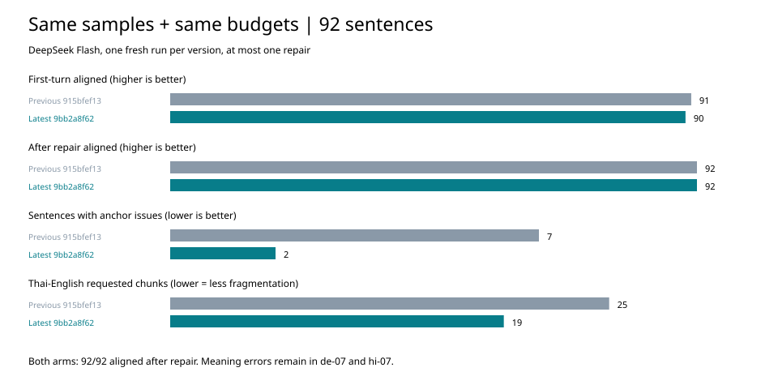

# Latest-version acceptance: 9bb2a8f62

**Conclusion: structure and automated regression pass; semantic acceptance still does not pass.** In this round, both the latest version and the budget-matched previous version reached 92/92 accepted and 92/92 aligned after one re-run. The latest version cannot be used to claim an improved final alignment pass rate; the observed improvements are fewer citation problems and fewer Thai chunking hints. A single round of model sampling does not equal a stable gain.

## Versions and method

- Latest version: `9bb2a8f62`; previous-round comparison version: `915bfef13`, using the grader binary saved from the previous round, whose SHA-256 is saved in `source-verification.json`.
- Sample: the same 92 sentences (12 each from the real Korean, Chinese and Japanese projects, plus 56 synthetic). This round did not expand the scope of what is sent outside from the real projects.
- The two arms use **exactly the same source carrier, manifest and reading budget**; each is rendered (protocol/prompt), parsed and scored by its corresponding version, while the provider executor uniformly uses the version rebuilt in this round.
- The reading budget follows the current `reading_budget_duration`: duration × target-language cps, rounded down (zh=9, ja/ko=13, others=21). For the 36 real-project sentences, the original word start and end times are used; for the 56 synthetic sentences, the estimate is reference English translation word count / 2.7; for English source text, source word count / 2.7 is used directly. Per-sentence assumptions are saved in `budget-assumptions.json`; these are not measured reading times.
- Used the user-specified DeepSeek V4.1 Flash (config ID `deepseek-flash`), temperature=0.2, effort=auto. Each arm was sampled once independently, with at most one re-run; the latest version made 18 calls and the previous version 17 calls, 35 in total, and all requests succeeded.
- The historical 92 sentences without a budget were additionally replayed from fixed responses, **consistent with the full sentence-by-sentence scoring of the previous round**, still 80/92 aligned. This set is used for a regression check only and does not represent the effect of the production chunking prompt.

## Version comparison at the same budget

| Metric | Previous 915bfef13 | Latest 9bb2a8f62 |
| --- | ---: | ---: |
| First-round accepted / aligned | 91/92 | 90/92 |
| Accepted / aligned after one re-run | 92/92 | 92/92 |
| Sentences with citation problems in first round | 7 | 2 |
| Chunks located in first round / all chunks | 440/441 | 425/425 |
| Total minimum chunks for the 6 Thai→English requests | 25 | 19 |
| Final alignment in the sample from the three real projects | 36/36 | 36/36 |

First-round citation problems are problem flags from the grader and cannot be taken as a statistic of overall translation quality; the number of accepted sentences in the two arms above also differs. After the re-run, all language groups reached their full sample count. In the latest version, Chinese `s-g133.0` and Japanese `s-g165.0` were not accepted in the first round and were recovered by the re-run. No needs-rewrite or sentence-level residue was found.



In this batch, the new dictionary boundary gate for Chinese and Japanese changed the prompt text of 7 Chinese sentences and 8 Japanese sentences; the total number of prompt chunks did not change, and the change is in the source-side breakpoint positions. Thai→English reduced request chunks by 6, about 24%. This batch did not reproduce the overall problem of earlier over-fragmented chunking such as "120 | baht", but native-speaker fluency was not scored for each subtitle.

## Content review: still not all green

1. **German de-07 is unresolved.** The new response “只有在第二版负责人批准后，才把文件发给安娜。”(Only after the second-version owner approves will the file be sent to Anna.) still misreads “管理层批准第二版”(management approves the second version) as “第二版负责人批准”(the second-version owner approves). It was judged as aligned.
2. **Hindi hi-07 has a confirmed omission.** The new response “在经理批准另一个版本之前，不要把文件全部发出去。”(Do not send all the files out before the manager approves another version.) omits the recipient Sara and adds “全部”(all). Here the ambiguity of “第二版/另一个版本”(second version / another version) is not used as the basis for the error. The same-budget response of the old version has the same error, so this cannot be attributed to the newly added chunking rule in this round.
3. **Thai th-02 did not reproduce the error in this round.** The new and old same-budget responses both correctly write “close the windows”; they keep "below 5 degrees" and close the windows before turning on the heating. A single success does not prove that the "front panel" error has disappeared permanently.
4. `th-05`: the latest translation has an extra space after the quotation mark (`“ confirmed”`); the two Thai→Chinese sentences lack natural pause punctuation, so there is still room to improve text quality. They do not affect the structural pass count in this round.

The semantic conclusions come from a human-style review of the saved text; no blind native-speaker evaluation was done and no independent model re-check was used, so no semantic accuracy is reported. The designed cross-model meaning-check trial has not yet been connected to production, and this round does not treat it as a protection already in place.

## Polish, multilingual and safety-boundary regression

`cargo test --locked -p ccut-flow-core -p ccut-speech-core -p ccut-engine`:

| Scope | Passed | Ignored | Failed |
| --- | ---: | ---: | ---: |
| flow-core (including golden, carrier, multilingual) | 968 | 1 | 0 |
| speech-core | 47 | 0 | 0 |
| engine | 211 | 0 | 0 |
| Total | **1226** | **1** | **0** |

- The newly added multilingual cases now cover 25 scenarios and 50 polishing/translation tasks; all three data-driven regression suites pass, including word ID/timing preservation, rejection of copied source text, and intra-word chunk protection. They use fixed answers; this round did not call the polishing model anew.
- The architecture check `provider_http_calls_are_built_in_exactly_one_place` from the previous round has passed.
- 1000 dual-interval cross probes: 0 false passes; each group still has 15 safe breakpoints passing.
- All 10 Unicode tokenization and glue-concatenation probes kept the original text.
- The local projection of 346 sentences across the three real projects is byte-identical to the previous round, and the source file SHA-256 is unchanged before and after; nothing was written back to the real projects.

Before the build, flow-core / engine were cleaned, and `lean_carrier_grade` / `provider_carrier_bench` were rebuilt, taking 15.92 seconds; all four related artifacts are `fresh: false`. The tests used a copied binary from this round; the source digests of the three related crates are unchanged before and after. One existing unused_mut warning is kept. Not done: App/Web UI, video export, full Runtime translation transactions, or full-workspace verification.

## Files and re-verification

- `pages/`: budget inputs and manifest shared by both arms.
- `latest/`, `previous/`: store the exact requests, raw responses, first-round scores and final per-sentence results, respectively.
- `replay-summary.json`: replay of the latest version against the previous round's old responses and old inputs, fully consistent with the previous round's records.
- `build-proof.json`, `source-verification.json`: version, build freshness, test counts and source/binary digests.
- `property-results.json`, `real-project-check.json`: cross probes, Unicode and real-project checks.

Re-verify the latest version (without calling the model):

```bash
cd core && cargo build --locked -p ccut-flow-core --example lean_carrier_grade
cd ..
CCUT_BENCH_TARGET="$(cd core && cargo metadata --no-deps --format-version 1 | python3 -c 'import json,sys; print(json.load(sys.stdin)["target_directory"])')"
python3 scripts/bench/fixtures/lean-carrier-acceptance-2026-10-01-9bb2a8f62/replay.py \
  --grader "$CCUT_BENCH_TARGET/debug/examples/lean_carrier_grade"
```

To check the previous arm, pass `--arm previous` and use the grader corresponding to 915bfef13; do not overwrite the old scores with the latest version. If the code later changes intentionally, review the differences and create a separate acceptance record.
