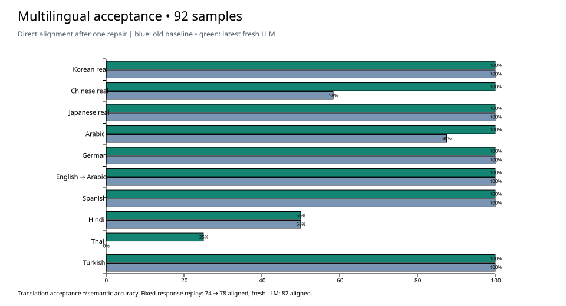

# Multilingual Acceptance: 2026-10-01

Acceptance code: `6f710387a`. The fixed data comes from the [92-sentence benchmark of 2026-09-30](../lean-carrier-multilingual-2026-09-30/README.md), of which 36 sentences are real-project samples and 56 are synthetic. Conclusion: **the fix is effective, but it still does not meet the standard for all languages to ship subtitles directly.**

## Results

| Basis | Translation accepted | Directly aligned | Split needs rewriting | Whole-sentence degradation | Missing translation |
| --- | ---: | ---: | ---: | ---: | ---: |
| Old version, first round | 51 | 38 | 4 | 9 | 41 |
| New version, first round, same batch of old responses | 50 | 39 | 11 | 0 | 42 |
| Old version, after one repair | 87 | 74 | 4 | 9 | 5 |
| New version, same batch of old responses and old repair | 86 | 78 | 8 | 0 | 6 |
| New version, new DeepSeek first round | 92 | 79 | 13 | 0 | 0 |
| New version, new DeepSeek after one repair | 92 | 82 | 10 | 0 | 0 |

All denominators are 92. The one sentence that the old responses accepted less is Spanish `es-06`: the old version accepted a source-text fragment and a citation marker as the translation, while the new version correctly rejected it. The alignment gain on fixed response replay is **4 sentences**; the gain on the new model test compared with the historical benchmark is **8 sentences**, which includes differences in prompts, input tokenization and model sampling, so it cannot all be attributed to the algorithm.



| Source language group | Sample | Aligned after old repair | Aligned after new repair |
| --- | ---: | ---: | ---: |
| Korean (real) | 12 | 12 | 12 |
| Chinese (real) | 12 | 7 | 12 |
| Japanese (real) | 12 | 12 | 12 |
| Arabic | 8 | 7 | 8 |
| German | 8 | 8 | 8 |
| English→Arabic | 8 | 8 | 8 |
| Spanish | 8 | 8 | 8 |
| Hindi | 8 | 4 | 4 |
| Thai | 8 | 0 | 2 |
| Turkish | 8 | 8 | 8 |

## Failed Items and Recommendations

1. **Semantic errors are still judged as aligned.** The source of `de-07` requires that "the file is sent to Anna only after management approves the second version" (管理层批准第二版后，才向 Anna 发送文件). The new answer reads "Send only after Anna receives the file and the owner of the second version agrees" (只有在安娜收到文件并且第二版的负责人同意后，才发送。). It adds a "received" condition and misidentifies who approves. The old version's same sentence also had errors. Recommendation: in addition to the existing language and format validation, add content checks for sentences with conditions, negation or roles; in evaluation, score "alignment success" and "key facts correct" separately. The 100% acceptance rate in this round cannot be used to claim 100% translation accuracy.
2. **Four Hindi sentences still cannot be located.** `hi-03`, `hi-05`, `hi-06` and `hi-07` remain `anchor-unresolved` after one additional repair. The responses contain multi-segment ellipsis markers such as `लेकिन..नहीं..था` (lit. "but..not..was") and endpoint combinations of source words that do not exist in the source. Recommendation: the repair request should carry the specific failed reference, the failure reason and optional source-word endpoints, and legality should be verified separately. The repair in this round was generated through the grader's `render-fix` interface and does not cover all repair waves of the full production orchestration.
3. **Six Thai→English sentences are still split too coarsely.** The citations can now be located, but after re-tokenization there are not enough source-word boundaries within each sentence, and one repair still returns the whole sentence unchanged. The next step should be a Thai tokenization or subword boundary scheme that preserves word IDs and time mapping, then verification of contiguous intervals and subtitle length, rather than repeatedly asking the model the same question.
4. **Hindi `hi-07` still carries a content risk.** The sample requires "第二版" (the second version); the new answer and the repair both write "another version" (另一个版本). This deviation was found in this content review. No native-speaker blind review or full semantic accuracy statistics were done.

## Confirmed Fixes

- Chinese real-project 12 sentences: from 0 accepted in the historical first round and 7 aligned after repair, to 12 accepted in this round's first round and 12 aligned. The earlier issues of copying the source text or producing the wrong target language did not recur in this batch.
- `es-06`: the old wrong answer was rejected; the new answer fully preserves Inés / Mateo and "set off first, arrive ten minutes late" (先出发、晚到十分钟).
- 1000 double-interval cross probes: 0 false passes; each language still has 15/100 safe breakpoints passing, so the check has not degraded to rejecting everything.
- All 6 Unicode tokenization round-trip probes preserved the original text; the previously failing Thai `พื้นที่` and Korean `도쿄 여행` (Tokyo trip) now pass.
- Local reading and derived projection of the Korean / Chinese / Japanese real projects: 73 / 84 / 189 sentences, 3436 / 2461 / 6580 words; all succeeded, and the file SHA-256 values were identical before and after reading. This is not a new model translation test of the full 346 sentences.

## Build and Test

First run `cargo clean -p ccut-flow-core -p ccut-engine`, then build `lean_carrier_grade` and `provider_carrier_bench`. The build took 118 seconds (excluding waiting for other tasks to release the lock); all four components show `fresh: false`. Test after copying this round's executables; the Rust source within the test scope matches the digests taken before the build.

`cargo test --locked -p ccut-flow-core`: 913 unit tests + 3 golden + 20 carrier = **936 passed, 1 ignored, 0 failed**. The App and Web UI were neither compiled nor verified, and exported video playback and a full Runtime translation transaction were not executed.

The new model used the DeepSeek V4.1 Flash specified by the user (configuration ID `deepseek-flash`). The first round covered 16 pages; one repair round covered 5 pages / 13 sentences; all 21 calls succeeded. Only the fixed sample set was sent; the full corpora of the three projects were not sent. Model sampling was run only once and does not represent a stable pass rate.

## Files and Re-verification

- `requests.json` / `fix-requests.json`: this round's exact requests; `responses/`: the 21 raw model responses.
- `pages/`: this round's source carriers and manifest. Real samples keep their original words and timing; synthetic samples have their words rebuilt with the new `atomize`.
- `live-summary.json`: per-sentence scores for the new responses; `replay-summary.json`: scores of the old inputs and old responses under the new version; `reatomized-summary.json`: scores of the old responses after the synthetic tokenization was rebuilt. The last two totals are identical in this round.
- `property-results.json`: cross probes and Unicode round-trip; `real-project-check.json`: local checks of the real projects.
- `build-proof.json` / `source-verification.json`: version, source digests, build freshness and test artifact digests.
- `replay.py`: replays this round's new responses and compares them sentence by sentence with the saved results, without calling the model.

```bash
cd core && cargo build --locked -p ccut-flow-core --example lean_carrier_grade
cd ..
CCUT_BENCH_TARGET="$(cd core && cargo metadata --no-deps --format-version 1 | python3 -c 'import json,sys; print(json.load(sys.stdin)["target_directory"])')"
python3 scripts/bench/fixtures/lean-carrier-acceptance-2026-10-01/replay.py \
  --grader "$CCUT_BENCH_TARGET/debug/examples/lean_carrier_grade"
```

The replay first checks the first-round results, then regenerates the fix pages using the same first-round selection. This avoids mapping old fix line numbers to the wrong sentences after the version changes. When the algorithm is intentionally changed later, review the differences and save the result as a new acceptance record.
