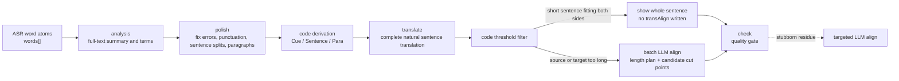

> Ported from CucCut v2. The data model names in this document (such as TranscriptDoc) refer to the v2 models. For how they map to the v3 document model, see [Architecture design §14](../../architecture/architecture-design.md#14-items-pending-review).

# ccut Post-Transcription Subtitle Pipeline Implementation Notes

This document explains how ccut, after speech transcription finishes, turns word-level ASR results step by step into subtitles that can be edited, translated and exported. It focuses on four stages that are easy to confuse:

- `segment`: semantic paragraph planning;
- `polish`: correct ASR output, add punctuation, split sentences, and generate paragraphs on the first run;
- `translate`: produce natural translations by complete semantic sentence;
- `align`: split a complete translated sentence into displayable subtitle fragments and re-anchor them to the source word timeline.

This document reflects the working-tree implementation as of 2026-07-30. The format and design background can still be found in the [ccut AI pipeline design](ccut-ai-pipeline-design.md) and the [Transcript v0.3 design](ccut-transcript-v03-design.md), but this document prioritizes describing the path the current Rust code actually executes.

## 1. Conclusions First

### 1.1 `words[]` is the only persisted source of truth for text and timing

ccut does not treat Cue, Sentence and Paragraph as a separate subtitle body that can be edited independently. The project's `transcript.json` is centered on `words[]`:

```jsonc
{
  "words": [
    {
      "id": "g1.0",
      "t0": 9.93,
      "t1": 10.20,
      "text": "Now,",
      "sp": "s1"
    },
    {
      "id": "g1.1",
      "t0": 10.20,
      "t1": 10.61,
      "text": "ChatGPT",
      "sp": "s1"
    }
  ]
}
```

Each word has all of the following at once:

- a stable id;
- media timing `t0..t1`;
- its current text;
- a speaker id.

All later structures are either derived from the word stream or written to a sparse override table keyed by word id. This guarantees that:

1. the LLM never directly decides timestamps;
2. when a small amount of text is changed, the ids and timings of unchanged words can stay where they are;
3. Cues, sentences, paragraphs and translated fragments can be re-derived at any time;
4. whether each stage is stale can be computed from fingerprints, rather than relying on process state that tends to drift.

Corresponding implementation:

- [`doc.rs`](../../../core/crates/ccut-flow-core/src/doc.rs)
- [`cue.rs`](../../../core/crates/ccut-flow-core/src/cue.rs)
- [`sentence.rs`](../../../core/crates/ccut-flow-core/src/sentence.rs)

### 1.2 `segment` and "subtitle line breaking" are not the same thing

In ccut:

- `segment` decides topic paragraphs, which are finally written to `paraBreaks`;
- `derive_cues` decides how source subtitles are broken into lines;
- `derive_sentences` decides the complete semantic sentences used for translation;
- `align` decides how a complete translated sentence is split into target subtitle fragments.

So "segment" is closer to the paragraph organization of an article than to each individual SRT subtitle entry. The final subtitle lines are derived dynamically by the code, based on words, punctuation, pauses, width and `transAlign`.

### 1.3 The LLM proposes semantics; the code maintains boundaries, timing and invariants

The basic division of labor across the pipeline is:

- the LLM is good at understanding the full text, correcting errors, splitting sentences, planning paragraphs, translating, and mapping meaning across languages;
- the Rust code is responsible for pagination, id reconciliation, text coverage checks, LCS mapping, word rebinding, timing interpolation, fingerprints, split budgets, contiguous-interval validation, degradation and export projection.

It is not "save whatever the LLM outputs", but "the LLM gives a candidate answer, and the code proves it is safe to write to the database".

### 1.4 The currently recommended high-performance path

```bash
ccut auto video.ccut --polish --lang zh

ccut check video.ccut --for srt --lang zh --strict

# Only re-cut targeted cues when check still reports stubborn alignment problems
# ccut refine-align video.ccut --lang zh
```

The actual stages are:



The first `polish` run writes `paraBreaks` and `stages.segment` from its own paragraph grouping, so an ordinary translation task does not need to run `ccut segment` separately first. A standalone `segment` is mainly for tasks that "need paragraph structure but do not want the body text polished". Subtitle Studio hands all long sentences to the LLM in batches by default, completing semantic splitting and length balancing in the first pass; `refine-align` only handles the stubborn residue left after check.

## 2. Persistence Layer and Derived Layers

### 2.1 Hierarchy

| Level | Persisted | id | Purpose |
| --- | --- | --- | --- |
| Word | Yes | `g1.4` / `w...` | The sole source of truth for text, timing and speaker |
| Cue | No | `q-<first word id>` | Source subtitle display line |
| Sentence | No | `s-<first word id>` | Translation, dirty detection and alignment unit |
| Paragraph | No | `p-<first word id>` | Topic paragraph, pagination and edit navigation |
| Full translated sentence | Yes | `trans[lang][sentenceId]` | The source of truth for natural target-language text |
| Alignment overlay | Yes | `transAlign[lang][sentenceId]` | How the full translated sentence is cut for display |
| Target subtitle fragment | No | — | The final projection consumed by export, Studio and rendering |

The strict relationship is:

```text
word ⊂ cue ⊂ sentence ⊂ paragraph
```

One Sentence can cover multiple Cues. This lets the translation model see the complete semantic sentence, rather than having it forcibly cut by the visual line breaks of the source language.

### 2.2 How Cues are derived by the code

`derive_cues` scans all non-hidden words in order and closes a cue under the following conditions:

1. a manual `break`;
2. a speaker change;
3. sentence-final punctuation (unconditionally closes unless an explicit `nobreak` is present);
4. clause punctuation while the current line has reached the minimum length (dashes use a lower threshold);
5. a pause of at least 0.6 seconds between words while the current line has reached the minimum length;
6. the line width exceeds `maxChars` after adding the next word (the next word is pulled in together with its punctuation only when that word ends in clause or sentence punctuation and the total width still stays within `maxChars + overflowSlack`).

Default parameters are:

```text
maxChars = 42
pauseSec = 0.6
minClauseChars = 12
minPauseChars = 20
minDashChars = 6
overflowSlack = 8
minCueDisplaySec = 1.0
```

`nobreak` can suppress the default sentence-final, punctuation, pause and overflow breaks, but it cannot suppress manual hard breaks or speaker changes.

The pinned table read by derivation is `autoBreaks[layoutProfile] ⊕ breaks` (transcript 0.4): `breaks` stores only explicit user intent, while `autoBreaks` stores the optimizer output keyed by `LayoutProfile` id (defaulting to `default`); on the same key, the user's `breaks` takes precedence. The three ends (Rust `derive_cues`, Swift `TranscriptModel.cues`, and the designs prototype `VK_MODEL.cues`) perform only this one map merge; the derivation algorithm itself is unchanged.

Derivation remains greedy. Reading-speed balancing (reclaiming orphaned short tails, reflowing or merging gaps around cues that are too fast, and avoiding dangling word endings) is computed in one pass by the global DP over candidate breakpoints in `ccut-flow-core::layout` at polish/segment write-back time: user `break`s, speaker changes, `paraBreaks` and sentence ends are hard boundaries; user `nobreak` is a forbidden boundary; all other positions are scored by seam level (sentence end 0 < clause punctuation 0.3 < pause 0.5 < ordinary word gap 0.8 < dangling tail 1.5 < CJK intra-word 3.0), reading speed (the `LayoutProfile` warn/bad thresholds), duration (min/max duration, with the time window following the lead-in/tail silence convention), orphaned short tails, and under-filled cues, and then chosen as a whole. The optimizer **always runs** (it no longer skips when a pinned set already exists). The result is written as the minimal pinned set at the points where it diverges from what `auto_break` replay would produce, into `autoBreaks[layoutProfile]`, and **never into `breaks`**; the derivation side can reproduce it by replaying from `words + autoBreaks ⊕ breaks`. The threshold source is `ccut-flow-core::layout_profile::LayoutProfile` (`default` = all existing constants).

### 2.3 How Sentences are derived by the code

`derive_sentences` merges consecutive Cues into translation sentences. A sentence is closed when any one of the following conditions holds:

1. the last word has sentence-final punctuation;
2. the gap between the next Cue and the current Cue is at least 1.8 seconds;
3. a speaker change;
4. the current sentence reaches 80 words;
5. the first word of the next Cue is pinned by `paraBreaks`;
6. the next Cue crosses a chapter boundary.

Pauses of 0.6–1.2 seconds can split source Cues, but they do not automatically split translation sentences. For example:

```text
An agent is an LLM with tools
    [0.62s pause]
running in a loop to accomplish
    [1.08s pause]
a goal.
```

This can be derived into three source Cues, yet it remains one complete Sentence:

```text
An agent is an LLM with tools running in a loop to accomplish a goal.
```

This distinction matters a great deal for natural translation.

### 2.4 How Paragraphs are derived by the code

`derive_paras` groups by "chapter × consecutive same speaker", then overlays `paraBreaks`. `paraBreaks` is a sparse table keyed by the "first word id of a new paragraph":

```json
{
  "paraBreaks": {
    "g5.0": true,
    "g12.4": true
  }
}
```

This means that `g5.0` and `g12.4` each open a new paragraph, rather than storing a duplicate paragraph body.

## 3. Which Steps Depend on the LLM and Which on Code

| Step | LLM responsibility | Rust code responsibility | Behavior when the LLM fails |
| --- | --- | --- | --- |
| Cue derivation | None | Punctuation, pauses, width, override-table rules | Not applicable |
| Sentence / Para derivation | None | Sentence ends, strong pauses, speakers, chapters, paragraph pins | Not applicable |
| analysis | Summary, terms, named entities | Pagination, cache fingerprints, variant filtering | Non-terminal errors can be ignored; polishing continues without a brief |
| polish | Error correction, punctuation, semantic sentence splitting and paragraphing | LCS mapping, similarity gate, rebind, timing repair, degradation | Original words are kept; split by the sentence-end / 30-word rule |
| standalone segment | Punctuation and topic paragraph suggestions | Coverage proof, boundary mapping, hard speaker breaks, fallback | After the index contract, fall back to pure rule-based segmentation |
| translate | Natural, faithful complete-sentence translation | Sentence derivation, pagination, CPS budget, id reconciliation, incremental writes to disk | Terminates after retries are exhausted; never fabricates machine translation |
| `independent` align | None | Target-language DP splitting, proportional word anchors, timing smoothing | Not applicable |
| `manyToOne` align | Selects synchronized semantic fragments according to the two-sided length plan | Long-sentence detection, candidate word boundaries, coverage/hard/lint validation, global repair budget | Failed sentences fall back to deterministic target-language splitting |
| check / export / Studio projection | None | stale, coverage rate, CPS, width, flicker, timing projection | Not applicable |

"LLM failure" here does not include terminal configuration errors such as 401, 403 or a nonexistent model. Such errors stop the task directly, so that degraded results do not mask the configuration problem.

## 4. The Unified LLM Call Layer

All four AI stages depend only on the `LlmJson` trait in `ccut-flow-core`:

```rust
pub trait LlmJson {
    fn complete(&mut self, request: &LlmRequest) -> Result<String, LlmError>;
}
```

The engine itself has no network or file I/O. The CLI provides two executors.

### 4.1 Provider mode

```bash
ccut polish project.ccut --llm provider:openai/model-name
```

The CLI sends requests directly to an OpenAI-compatible or Anthropic API. Most providers use `response_format={"type":"json_object"}`; for models that do not support this parameter, the parameter is removed and the request is retried after the corresponding HTTP 400.

### 4.2 Agent mode

Agent is the default mode:

```bash
ccut polish project.ccut --llm agent
```

Each call creates files:

```text
project.ccut/tasks/t-.../
├── contracts/polish.md
├── payloads/c0001.json
├── requests/c0001.json
├── claims/c0001.json
└── responses/c0001.json
```

An external Agent claims a call with `task claim`, reads the contract and payload, writes the JSON answer to a temporary file, and then submits it with `task submit`. The engine continues execution once it receives the response file.

Provider and Agent differ only in "who generates the answer". They do not affect subsequent parsing, validation, retries, persistence or logging.

### 4.3 Three-layer structured validation

LLM output passes through the following, in order:

1. JSON-mode prompting or the provider's `response_format`;
2. `decode` extracts the outermost `{...}` from the response, tolerating Markdown code fences;
3. each engine's own deterministic semantic validation.

By default it makes at most 3 attempts, with a 2-second retry backoff, and passes the specific problem from the previous attempt to the next call through `retry_reason`.

Every call is written to:

```text
project.ccut/logs/llm/<kind>.jsonl
```

Each record includes the kind, the executor, the model or worker, the input, the response, the error and the duration, for auditing and performance analysis.

## 5. Segment: paragraph planning

Implementation entry points:

- [`segment.rs`](../../../core/crates/ccut-flow-core/src/engines/segment.rs)
- CLI: `ccut segment <project>`

### 5.1 What the LLM sees

The code first renders the word stream as plain text and adds read-only metadata between words:

| Marker | Trigger condition | Meaning |
| --- | --- | --- |
| `⏸` | gap ≥ 0.6s | short pause |
| `⏸⏸` | gap ≥ 1.0s | medium pause |
| `⏸⏸⏸` | gap ≥ 1.8s | long pause |
| `⏹` | speaker changes | must cross a segment boundary |

Illustrative input:

```text
Today we are launching ChatGPT ⏸ on web desktop and mobile ⏹
Now let us look at the data
```

The Segment LLM's task is narrow:

1. keep the original text word for word;
2. only add or correct punctuation;
3. organise the text into paragraphs by topic, usually 1–4 sentences each;
4. never cross speakers;
5. return:

```json
{
  "paragraphs": [
    "Today we are launching ChatGPT, on web, desktop, and mobile.",
    "Now let us look at the data."
  ]
}
```

### 5.2 How the code proves an answer is safe to use

The current implementation's effective ladder is:

#### Tier 1: exact

Both the source words and the LLM paragraphs are passed through `normalize_chars`, which ignores punctuation, whitespace and case. If the two character streams are identical, the code can map each paragraph boundary back to a word index using O(n) character offsets.

#### Tier 2: diff

If the model changed a small number of characters in passing, the code runs the same `atomize` on both sides and then computes an atom-LCS. A boundary is accepted only if the match rate is at least 0.75.

Even when the boundaries can be recovered, a paragraph's LLM text is not stored unless it passes the strict text gate of "punctuation-only changes" against its corresponding source word range. The code uses only the boundaries, and the body text falls back to the original words.

#### Tier 3: currently omitted

The historical design included a cursor-based range recovery layer. The current Rust implementation explicitly omits it and goes straight to the index contract.

#### Tier 4: index contract

After all three text-contract attempts fail, one more LLM request is sent with a simpler format:

```json
{
  "paragraphs": [
    {"startWordIndex": 0, "endWordIndex": 18},
    {"startWordIndex": 19, "endWordIndex": 31}
  ]
}
```

The code clamps the ranges, checks their order and overlaps, and automatically snaps gaps of no more than 10 words.

#### Tier 5: deterministic fallback

If the index contract still fails, the code stops relying on the LLM entirely and splits paragraphs by these rules:

- a speaker change;
- a pause of at least 1.2 seconds;
- a sentence-ending mark once 200 characters have accumulated;
- a hard break at 400 characters.

This path never drops words.

### 5.3 What is written back

Legal punctuation added by the LLM is written back to `words[]` through `rebind_corrected`. Paragraph boundaries are saved as `paraBreaks` on the first word of each new paragraph. Existing manual paragraph pins are not cleared.

At the same time, this is written:

```jsonc
{
  "stages": {
    "segment": "<id_fingerprint(words)>"
  }
}
```

`segment` uses an id fingerprint, so the paragraph structure can stay fresh when the plain text changes but the word ids do not. It expires naturally only after a re-transcription issues new ids.

## 6. Polish: correction, punctuation, sentence splitting and paragraphs

Implementation entry points:

- [`brief.rs`](../../../core/crates/ccut-flow-core/src/engines/brief.rs)
- [`polish.rs`](../../../core/crates/ccut-flow-core/src/engines/polish.rs)
- [`rebind.rs`](../../../core/crates/ccut-flow-core/src/rebind.rs)
- CLI: `ccut polish <project>`

### 6.1 Run analysis first

The CLI first reads `ai/brief.json`. It is reused only if its content fingerprint matches the current word stream; otherwise the LLM is called to extract:

```json
{
  "summary": "The video introduces how ChatGPT connects to tools and completes work.",
  "terms": [
    {
      "term": "ChatGPT",
      "note": "product name",
      "observedVariants": ["Chat GBT"]
    }
  ],
  "namedEntities": ["ChatGPT", "Codex", "Mexico"]
}
```

Long transcripts are split into pages of 8000 characters, and the results from multiple pages go through one more LLM call to merge them. The code removes any `observedVariants` that do not actually appear in the source text, to prevent the model from inventing wrong variants.

An ordinary analysis failure does not block polish; only terminal errors such as authentication stop the task. Without analysis, polish can still run, but it lacks the whole-text summary and the term lock.

### 6.2 The Polish LLM contract

The input is still the word stream with `⏸` / `⏹`, but it is passed as JSON keyed by global word index:

```json
{
  "words": {
    "0": "Today",
    "1": "we",
    "2": "launch",
    "3": "Chat GBT ⏸",
    "4": "on",
    "5": "web"
  }
}
```

The LLM may:

- fix obvious ASR errors;
- add punctuation;
- split sentences by meaning;
- organise consecutive sentences into paragraphs.

It may not translate, rewrite, summarise, add, remove or reorder content. The response carries no times and no word indices:

```json
{
  "paragraphs": [
    {
      "sentences": [
        "Today we launch ChatGPT on web.",
        "It is also available on desktop and mobile."
      ]
    }
  ]
}
```

### 6.3 How the code maps back to words

1. The source words and the output sentences go through the same `atomize`;
2. an atom-LCS is computed between the two sides;
3. if the overall match rate is below 0.7, the whole page's attempt fails;
4. each output sentence's initial boundary is set by its last matched source word;
5. adjacent boundaries may move within a ±10-word window, but a move is accepted only if "similarity on both sides does not drop and at least one side improves";
6. boundary moves must not break speaker consistency.

### 6.4 Two layers of similarity protection

The sentence-level low-similarity thresholds are:

- Latin text: 0.70;
- CJK text: 0.75.

If more than 30% of the sentences on a page are low-similarity, the whole page is retried. Otherwise the page structure is accepted first, and the low-similarity sentences are grouped into one `polish-retry` call, carrying:

```json
{
  "startWordIndex": 120,
  "originalWords": "Chat GBT can do work",
  "previousAttempt": "ChatGPT can complete work",
  "contextBefore": "...",
  "contextAfter": "..."
}
```

If the retry is still unsafe, that sentence has its `corrected` cleared and is marked as fallback, and the original words are kept in the end.

### 6.5 How Rebind keeps the timeline intact

`rebind_corrected` does not crudely overwrite the original word array with the LLM's text:

1. strip the common prefix and suffix;
2. run a word-level LCS over the changed span;
3. matched words keep their id, `t0` and `t1` unchanged;
4. new tokens get `w...` ids;
5. new tokens are interpolated by character weight within the original time window;
6. finally, time monotonicity and boundary normalisation are enforced.

Example:

```text
Source words:
g1.3  2.00–2.60  "Chat"
g1.4  2.60–3.10  "GBT"

Polished:
"ChatGPT"

Result:
w...  2.00–3.10  "ChatGPT"
```

The changed span may get new ids, but other words are completely unaffected. Stale detection for translation can therefore be exact down to the sentence.

### 6.6 Why the first Polish run also completes segment

The `run_polish` response is already organised into paragraphs. If `stages.segment` has never existed, the code:

1. takes the first word id of each LLM paragraph;
2. from the second paragraph onward, writes `paraBreaks[id] = true`;
3. writes `stages.segment = id_fingerprint(words)`;
4. updates `stages.asrLayout`.

So in the standard translation chain:

```text
transcribe → polish → translate
```

sentence splitting and paragraph structure already exist. Running `segment` separately beforehand would make the LLM do roughly the same work again on the same full text, adding latency.

### 6.7 Polish outputs

Besides updating `transcript.json`, the CLI also writes:

```text
ai/brief.json
ai/polish.json
```

`polish.json` contains:

- sentence records with word ids and time ranges;
- `typo` / `punct` edit suggestions;
- the grouping of paragraphs into sentence indices;
- the number of fallback pages;
- candidates for speakers' real names.

## 7. Translate: full semantic sentence translation

Implementation entry points:

- [`translate.rs`](../../../core/crates/ccut-flow-core/src/engines/translate.rs)
- [`sentence.rs`](../../../core/crates/ccut-flow-core/src/sentence.rs)
- CLI: `ccut translate <project> --lang zh`

### 7.1 The translation unit is not the Cue

The code first derives Cues, then merges 1..N Cues into a Sentence. The translation key is:

```text
s-<first-word-id-of-sentence>
```

For example:

```text
q-g1.0  Now, ChatGPT goes from just answering questions
q-g1.7  to doing work for you by connecting to all of your tools.
```

These may form one translation sentence:

```text
s-g1.0
Now, ChatGPT goes from just answering questions to doing work for you by
connecting to all of your tools.
```

### 7.2 Incremental selection

Each sentence gets a `src_fingerprint`. Before translation starts, the code:

1. deletes orphaned `trans`, `transSrc` and `transAlign` keys that no longer correspond to any current Sentence;
2. finds sentences with no translation;
3. finds stale sentences whose `transSrc` does not match the current sentence fingerprint;
4. with `--force`, selects all sentences;
5. skips any other sentence that already has a fresh translation, with no LLM call.

### 7.3 Request format and reading budget

The sentences to translate are packed by source character count, with a default of 6000 characters per page. Adjacent pages supply only static source context and do not depend on the previous page's translation:

```json
{
  "lang": "zh",
  "context": "Preceding source: ...\nFollowing source: ...",
  "lines": [
    {
      "id": "s-g1.0",
      "source": "Now, ChatGPT goes from just answering questions to doing work for you by connecting to all of your tools.",
      "maxChars": 57
    }
  ]
}
```

`maxChars` is calculated from the sentence duration and the target language's CPS budget:

```text
maxChars = max(1, floor(sentenceDuration × targetCps))
```

Default CPS:

| Target language | CPS |
| --- | ---: |
| Simplified Chinese | 9 |
| Japanese / Korean | 13 |
| Thai | 15 |
| Arabic / Hindi | 18 |
| Other languages | 21 |

This budget is used to prompt the translation to be as concise as possible, but key information must never be dropped to meet it.

### 7.4 LLM output and code validation

The LLM returns only complete translated sentences:

```json
{
  "translations": {
    "s-g1.0": "现在，ChatGPT不再只是回答问题，还能连接你的所有工具，替你完成工作。"
  }
}
```

The code performs two-way id reconciliation:

- an unknown id appears: reject;
- any requested id is missing: reject;
- any translation is empty: reject;
- sentences are duplicated, merged or split: the contract does not allow it.

Translation and alignment are explicitly separated into two stages, so the translation model can use natural target-language word order and does not have to conform to source Cue boundaries.

### 7.5 Per-page persistence

Each page is written immediately upon completion:

```jsonc
{
  "trans": {
    "zh": {
      "s-g1.0": "现在，ChatGPT不再只是回答问题，还能连接你的所有工具，替你完成工作。"
    }
  },
  "transSrc": {
    "zh": {
      "s-g1.0": "19:g1.0:g1.18:..."
    }
  }
}
```

So `transcript.json` itself is the checkpoint for resumable runs. If the process fails on a later page, the sentences already completed remain; a rerun skips them automatically.

Unlike segment and polish, translate has no fallback that "generates an approximate translation by rule". If all three requests fail, the command returns an error, because fabricating an unreliable translation is more dangerous than failing explicitly.

## 8. Align: target subtitle splitting and time anchoring

Implementation entry points:

- [`align.rs`](../../../core/crates/ccut-flow-core/src/engines/align.rs)
- [`split.rs`](../../../core/crates/ccut-flow-core/src/split.rs)
- [`seam.rs`](../../../core/crates/ccut-flow-core/src/seam.rs)

### 8.1 Why align is still needed after translation

The complete translated sentence is the ground truth for language quality, but it often does not fit on screen at once. For example:

```text
现在，ChatGPT不再只是回答问题，还能连接你的所有工具，替你完成工作。
```

It needs to be split into:

```text
现在，ChatGPT不再只是回答问题，
还能连接你的所有工具，替你完成工作。
```

Align must also answer: which words of the source sentence each translated piece corresponds to, and when each piece should be displayed.

### 8.2 Three budgets

`TransParams` defines the budgets for each target language:

| Language | fit | soft | hard |
| --- | ---: | ---: | ---: |
| Chinese / Japanese / Korean | 16 | 14 | 20 |
| Other languages | 42 | 30 | 42 |

- `fit`: the single-line capacity that triggers splitting;
- `soft`: the length each piece should ideally approach;
- `hard`: the hard ceiling no translated piece may exceed.

For Simplified Chinese, the budget is first computed as a non-destructive delivery projection:

- Ordinary commas and periods do not count against the budget;
- Whitespace is not counted;
- Two Latin half-width characters are roughly equal to one Chinese reading unit;
- Internal punctuation in numbers, such as `1.2` and `1,000`, is kept.

If the full translated sentence exceeds neither fit nor hard, the code removes the unnecessary `transAlign` and lets the whole sentence cover the entire word time window of the Sentence directly. Source Cue count and boundaries do not take part in this check.

### 8.3 `independent`: pure code, target language first

```bash
ccut translate project.ccut --lang zh --align-mode independent
```

The code atomizes the translated sentence and uses dynamic programming to choose the seams:

- Sentence-final punctuation costs the least;
- Clause punctuation is next;
- Whitespace between words comes after that;
- CJK character boundaries come last;
- Each piece must not exceed hard;
- The overall result should stay as close to soft as possible;
- The number of pieces cannot exceed the number of source words.

After splitting, each piece is assigned at least one contiguous run of source words, in proportion to the cumulative reading units of the translated pieces. It does not establish a bilingual line-by-line semantic correspondence, so it suits monolingual target-language subtitles.

### 8.4 `oneToOne` (historical compatibility)

This mode depends directly on source Cues and has been retired. The enum value exists only so historical JSON can be read. The CLI rejects new requests, and historical entries are treated as invalid and fall back to whole-Sentence projection until they are realigned with `many-to-one` or `independent`.

### 8.5 `manyToOne`: the default semantic alignment

Default mode:

```bash
ccut translate project.ccut --lang zh --align-mode many-to-one
```

Sentences that are short on both sides do not call the LLM. Sentences where either the source or the target side is overlong are sent in batches of up to 32. For each sentence the code computes a language-aware `lengthPlan`: for space-delimited languages such as English, it counts words; for Chinese, Japanese and Thai, it counts reading characters; for Korean, it counts eojeol (space-separated word groups). It is still constrained by the hard limit on target display characters. The number of pieces is driven by both the source and the target language. Each side's `preferredPerPiece` is the balanced target when the meaning allows it. It is not permission to break fixed phrases or to cross word-order intersections.

The request also lists every legal `sourceBreakCandidates` entry. When the model revises, it returns only candidate ids and does not re-copy the source text, so a single transcript token such as `faster—for` can no longer be cut in the middle.

```jsonc
// request
{
  "budgets": {"fit": 16, "soft": 14, "hard": 20},
  "sentences": [
    {
      "key": "s-g1.0",
      "source": "Now, ChatGPT goes from just answering questions to doing work for you by connecting to all of your tools.",
      "target": "现在，ChatGPT不再只是回答问题，还能连接你的所有工具，替你完成工作。",
      "lengthPlan": {
        "pieceCount": {"min": 2, "max": 3, "recommended": 2},
        "source": {"lang": "en", "unit": "word", "total": 19, "preferredPerPiece": [7, 12]},
        "target": {"lang": "zh", "unit": "readingCharacter", "total": 32, "preferredPerPiece": [12, 20]},
        "targetDisplayUnits": 32,
        "targetHardDisplayUnits": 20
      },
      "sourceBreakCandidates": [
        {"id": "b9", "after": "questions", "before": "to", "seam": 1, "pause": 0, "risky": false}
      ],
      "draftSource": "Now, ChatGPT goes from just answering questions | to doing work for you by connecting to all of your tools.",
      "draftTarget": "现在，ChatGPT不再只是回答问题， | 还能连接你的所有工具，替你完成工作。",
      "draftSourceUnits": [9, 10],
      "draftTargetUnits": [14, 18],
      "draftWidths": [14, 18],
      "draftReady": true
    }
  ]
}

// response
{
  "sentences": [
    {
      "key": "s-g1.0",
      "sourceBreaks": ["b9"],
      "target": "现在，ChatGPT不再只是回答问题， | 还能连接你的所有工具，替你完成工作。"
    }
  ]
}
```

The model first ensures that each pair of pieces has the same meaning, that fixed phrases stay intact, and that no target piece exceeds hard. Then, where the meaning allows, it moves closer to `lengthPlan`. For example, `a new | AI-assisted coding tool` must be judged an invalid boundary. The program recovers the contiguous word ranges directly from `sourceBreaks`. The target side may only insert separators; it may not rewrite the text.

The source pause markers that Align uses are:

| Marker | Gap between words |
| --- | ---: |
| `⏸` | ≥ 0.25s |
| `⏸⏸` | ≥ 0.6s |
| `⏸⏸⏸` | ≥ 1.2s |

They are more sensitive than the pause markers in polish / segment, because here the task is to find display seams inside a sentence, not to judge sentence or paragraph boundaries.

### 8.6 How the code verifies manyToOne

An LLM response must satisfy all of the following at once:

1. The key is a requested Sentence, and it is not duplicated;
2. `sourceBreaks + 1` equals the number of translated pieces;
3. The source break ids are known, deduplicated and strictly increasing;
4. Boundaries that leave a high-confidence article, possessive or modifier dangling are rejected;
5. All source words are covered contiguously, without overlap or omission;
6. After the pieces are concatenated, the result equals the normalized full translated sentence;
7. Each piece does not exceed hard;
8. A middle piece may not end with a dangling connective;
9. A later piece may not unconditionally begin with a clitic particle such as “的、了、吗” (possessive, aspect and question particles);
10. A flash piece of 3 characters or fewer that can safely merge with a neighbour is rejected.

A better natural seam that lies between soft and hard is recorded only as advisory and does not block.

Sentences that pass within a batch are accepted immediately. Each batch holds at most 32 sentences and gets only one first-round call. The sentences that fail in every batch are merged and share one global repair call. Any that still fail fall back to deterministic splitting. The model input also includes a deterministic `draftSource` / `draftTarget`. When the draft already qualifies, the model can answer with a compact `useDraft`. It rewrites marker strings only for the boundaries that genuinely need improvement.

### 8.7 Targeted re-cut and deprecated compatibility parameters

`--align-local` is kept only for compatibility with old commands. It no longer bypasses the LLM for long sentences. The normal flow does not need `refine-align`; run it only when `check` still reports stubborn residue:

```bash
ccut refine-align project.ccut --lang zh
```

To specify sentences by hand, you can also run `ccut translate project.ccut --lang zh --align-only --sentences s-g1.0,s-g8.4`. A sentence that is still over the limit after one refinement round usually cannot be fixed by further re-cutting. Under the invariant that "the concatenated pieces must equal the full translated sentence", it should be rewritten more compactly, or reported as a known residue.

### 8.8 Example of `transAlign` on disk

In the earlier example there are 19 source words, and the cut falls at `questions | to`:

```jsonc
{
  "transAlign": {
    "zh": {
      "s-g1.0": {
        "mode": "manyToOne",
        "words": [
          "g1.0", "g1.1", "g1.2", "g1.3", "g1.4",
          "g1.5", "g1.6", "g1.7", "g1.8", "g1.9",
          "g1.10", "g1.11", "g1.12", "g1.13", "g1.14",
          "g1.15", "g1.16", "g1.17", "g1.18"
        ],
        "pieces": [
          {
            "from": 0,
            "to": 6,
            "text": "现在，ChatGPT不再只是回答问题，"
          },
          {
            "from": 7,
            "to": 18,
            "text": "还能连接你的所有工具，替你完成工作。"
          }
        ]
      }
    }
  }
}
```

`words` is a snapshot of the word ids inside the Sentence. Once the word sequence changes, the old split automatically becomes `align-stale`. The historical `cues` field is ignored when read, and new writes no longer produce it. Changing only the break of a source Cue does not invalidate the translated Cue.

### 8.9 How it becomes timed target subtitles

After `derive_trans_cues` validates `transAlign`:

- For new manyToOne entries, `from/to` map directly to the `t0/t1` of the corresponding source words;
- independent allocates contiguous source words in proportion to piece length;
- When the alignment is missing or invalid, the full translated sentence covers the first-to-last word time window of the whole Sentence.

The code then tries to:

1. When the total duration of the sentence is sufficient, smooth the boundaries between pieces so that each piece meets the minimum reading duration;
2. Use real silence that exists between adjacent subtitles to pad short pieces;
3. Not overlap the next subtitle, and not change the persisted word times.

So `transAlign` stores stable word anchors, and the final display times remain a projection that can be re-derived.

## 9. Fingerprints, staleness and incremental reruns

### 9.1 Stage stamps

```jsonc
{
  "stages": {
    "asr": "<content fingerprint>",
    "asrLayout": "<layout fingerprint>",
    "polish": "<content fingerprint>",
    "segment": "<id fingerprint>",
    "chapters": "<content fingerprint>"
  }
}
```

| State | Fingerprint | Staleness condition |
| --- | --- | --- |
| ASR | Word text | Current content no longer equals the original transcript |
| ASR layout | breaks / paraBreaks / hidden | Manual layout change |
| Polish | Word text | Body text is edited again after polishing |
| Segment | Word ids | Re-transcription or rebinding changes the structural ids |
| Chapters | Word text | Body text changes |
| Translation | Per-sentence source fingerprint | The source of that sentence changes |
| Align | Sentence word snapshot + concatenation invariant | Word structure inside the sentence, or the full translated sentence, changes |

Polish itself makes `asr` stale; this is an expected modification in the pipeline. When the CLI judges whether a human edited the text, it also compares the current content with `stages.polish`, so that normal polishing is not mistaken for a user edit.

### 9.2 Chain reactions of common edits

| Operation | Rerun needed |
| --- | --- |
| Edit the text of one translated piece and update the full translated sentence to match | No retranslation; keep `transSrc` |
| Edit the full translated sentence | Delete that sentence's `transAlign`; realign only |
| Edit the source word text | The Sentence's translation is stale; incremental retranslation |
| Edit only the break of a source Cue | The full translated sentence and the translated Cues both stay valid |
| Move a paragraph pin | The Sentence may be re-derived; orphaned translation keys are cleaned up on the next translation |
| Re-transcribe | Word ids are all reissued; all downstream structures are re-derived |

## 10. How `ccut check` closes out

`check` is executed entirely by code and does not call the LLM. It checks at least:

- Whether word times are non-negative and monotonic, with no illegal overlaps;
- Whether the target language has translations, and whether they are empty or only partially cover the Sentence;
- Whether `transSrc` matches the current Sentence fingerprint;
- Whether any orphan keys remain that no longer correspond to a current Sentence;
- Whether `transAlign` is missing, or violates the snapshot, concatenation or contiguous-coverage invariants;
- Whether target pieces exceed hard;
- Whether a piece still exceeds fit and an executable natural seam exists;
- Width, CPS and flash duration when delivering SRT/VTT.

Typical command:

```bash
ccut check project.ccut --for srt --lang zh --strict
```

Important states:

- `translation-stale`: must be retranslated; it is a blocker for delivery;
- `align-stale`: display falls back to whole-sentence on-screen; usually only a realignment is needed;
- `translation-overflow`: when delivering SRT/VTT, exceeding hard is a blocker;
- `align-overfit`: gives the sentence ids that can be targeted for refinement, with ready-made commands;
- `flash`: display duration is below the target-language reading budget.

## 11. A complete end-to-end example

The following example omits unrelated fields.

### 11.1 ASR word placement

```jsonc
{
  "words": [
    {"id":"g1.0","t0":9.93,"t1":10.20,"text":"Now","sp":"s1"},
    {"id":"g1.1","t0":10.20,"t1":10.61,"text":"Chat GBT","sp":"s1"},
    {"id":"g1.2","t0":10.61,"t1":10.92,"text":"goes","sp":"s1"},
    {"id":"g1.3","t0":10.92,"t1":11.20,"text":"from","sp":"s1"}
  ]
}
```

### 11.2 Polish

The LLM uses terminology from the full text to judge that `Chat GBT` is `ChatGPT`, and it adds punctuation. After the code verifies the similarity, it rebinds:

```jsonc
{
  "words": [
    {"id":"g1.0","t0":9.93,"t1":10.20,"text":"Now,","sp":"s1"},
    {"id":"w...","t0":10.20,"t1":10.61,"text":"ChatGPT","sp":"s1"},
    {"id":"g1.2","t0":10.61,"t1":10.92,"text":"goes","sp":"s1"},
    {"id":"g1.3","t0":10.92,"t1":11.20,"text":"from","sp":"s1"}
  ],
  "paraBreaks": {
    "g20.0": true
  }
}
```

### 11.3 Code-derived sentence

```text
s-g1.0
Now, ChatGPT goes from just answering questions to doing work for you by
connecting to all of your tools.
```

### 11.4 Translate

```jsonc
{
  "trans": {
    "zh": {
      "s-g1.0": "现在，ChatGPT不再只是回答问题，还能连接你的所有工具，替你完成工作。"
    }
  },
  "transSrc": {
    "zh": {
      "s-g1.0": "<current source sentence fingerprint>"
    }
  }
}
```

### 11.5 Default manyToOne align

```text
现在，ChatGPT不再只是回答问题，
还能连接你的所有工具，替你完成工作。
```

The LLM selects candidate cut-point ids over the source words and inserts the matching `|` only in the target language; the code anchors the two pieces to consecutive source words `0..6` and `7..18` and writes them to `transAlign`.

### 11.6 Final projection

```text
09.93 → 12.11
现在，ChatGPT不再只是回答问题，

12.11 → 16.28
还能连接你的所有工具，替你完成工作。
```

The display times here come from the source-word anchors and the projection algorithm, not from times returned by the LLM.

## 12. Key trade-offs in the current implementation

1. **The full translated sentence and the display split are separate.** Changing line breaks does not break the translation's truth; changing the translation only requires the alignment to be marked stale.
2. **The normal chain does not repeat segmentation.** The first polish pass already produces the semantic paragraphs.
3. **A failed translation never fabricates a result.** Segment, polish and align all have conservative fallbacks; translate has none.
4. **All long sentences are split semantically in batch on the first pass.** When the source or target text is too long, it goes to the align LLM; `refine-align` only handles stubborn sentences that remain after the check.
5. **Timestamps do not go to the LLM.** The model only decides the text and the semantic seams; timing is always derived from the source words.
6. **The current translate page loop is still serial.** It uses the static source text of neighbouring pages and has no semantic dependency on the previous page's translation, so it could run concurrently in the future, but `run_translate` currently executes pages in order.
7. **The alignment protocol only lets the model choose legal boundaries.** The current manyToOne returns source-word candidate ids and target-language separators, and the program reconstructs the word ranges; the model does not re-copy the source text and does not maintain `from/to`.

## 13. Code index

| Topic | Implementation |
| --- | --- |
| Transcript data model | [`doc.rs`](../../../core/crates/ccut-flow-core/src/doc.rs) |
| Cue / Paragraph derivation | [`cue.rs`](../../../core/crates/ccut-flow-core/src/cue.rs) |
| Sentence derivation and stale | [`sentence.rs`](../../../core/crates/ccut-flow-core/src/sentence.rs) |
| Pagination | [`paging.rs`](../../../core/crates/ccut-flow-core/src/paging.rs) |
| Pauses / speaker markers | [`markers.rs`](../../../core/crates/ccut-flow-core/src/engines/markers.rs) |
| Full-text analysis | [`brief.rs`](../../../core/crates/ccut-flow-core/src/engines/brief.rs) |
| Segment | [`segment.rs`](../../../core/crates/ccut-flow-core/src/engines/segment.rs) |
| Polish | [`polish.rs`](../../../core/crates/ccut-flow-core/src/engines/polish.rs) |
| Word rebinding | [`rebind.rs`](../../../core/crates/ccut-flow-core/src/rebind.rs) |
| Translate | [`translate.rs`](../../../core/crates/ccut-flow-core/src/engines/translate.rs) |
| Align | [`align.rs`](../../../core/crates/ccut-flow-core/src/engines/align.rs) |
| Target-language splitting and display projection | [`split.rs`](../../../core/crates/ccut-flow-core/src/split.rs) |
| Seam quality and local re-anchoring | [`seam.rs`](../../../core/crates/ccut-flow-core/src/seam.rs) |
| CLI orchestration and check | [`cmd/ai.rs`](../../../core/crates/ccut-kernel/src/cmd/ai.rs) + [`cmd/ai/check.rs`](../../../core/crates/ccut-kernel/src/cmd/ai/check.rs) |
| Provider / Agent executor | [`services/llm_exec.rs`](../../../core/crates/ccut-kernel/src/services/llm_exec.rs) |
| Hotspot batch refinement orchestration | [`cmd/refine.rs`](../../../core/crates/ccut-kernel/src/cmd/refine.rs) |
